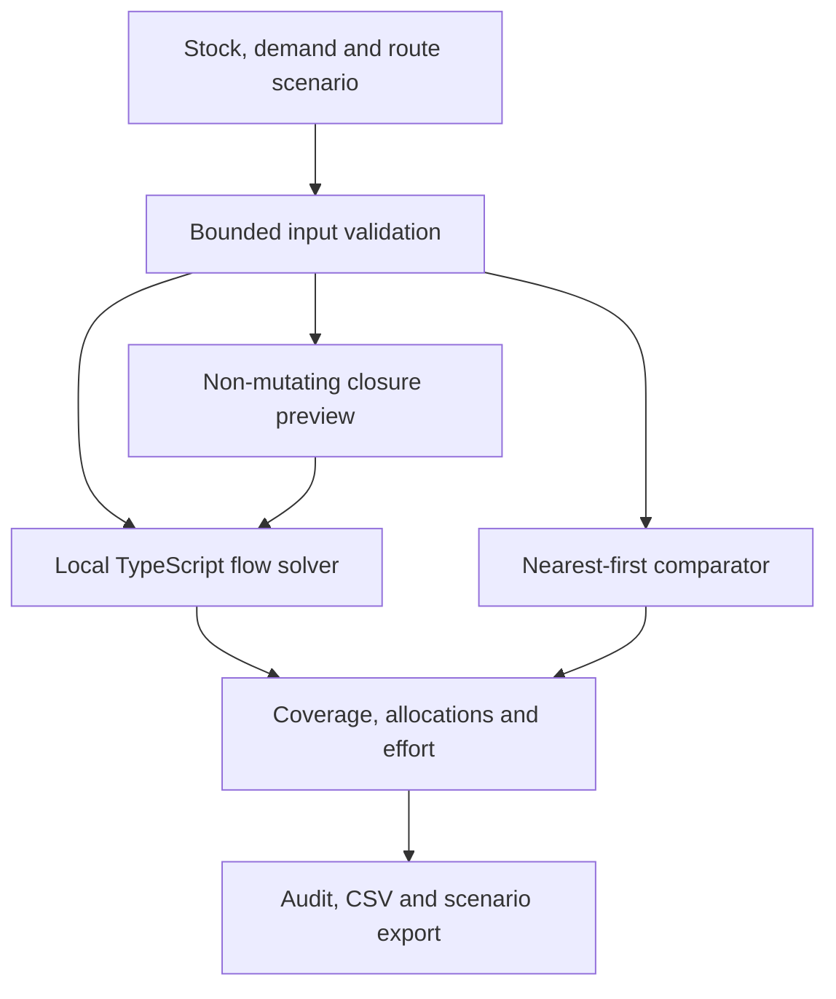

# RelayPlan

**Every community counts.** A browser-based relief allocation simulator that makes the trade-off between coverage and transport effort inspectable.


[Open RelayPlan](https://relayplan-eurekadev.vercel.app/) · [Walkthrough](https://relayplan-eurekadev.vercel.app/demo.html) · [Algorithm](docs/ALGORITHM.md) · [Research](docs/RESEARCH.md) · [Security](docs/SECURITY.md)

When stock is insufficient, delivering along the shortest routes first can leave a distant community without any allocation. RelayPlan lets community volunteers and students compare explicit allocation objectives, inspect unmet need, preview a route closure, and export a reproducible scenario.

Created on 13 October 2026 for Adeel Falak Sher and Raouf Khalid's EurekaDev 2026 team, Coding Track, **Problem in the Community**. This is a tabletop planning prototype, without field deployment, volunteer testing or operational approval.

## The workflow

| Explore | Compare | Reproduce |
| --- | --- | --- |
| Edit depot stock, community demand and route capacities | Inspect coverage, delivery and transport effort | Export allocation audit, CSV or scenario JSON |
| See disconnected and zero-demand communities | Compare against a labeled nearest-first heuristic | Import the scenario to repeat the exercise |
| Preview a closure without changing the scenario | Apply a closure only after reviewing the preview | Reset the fictional exercise |

The default River district exercise has 180 kits and 300 kits of demand. RelayPlan allocates **42, 36, 54 and 48 kits**, giving every community 60% coverage. The simple nearest-first comparator delivers the same 180 kits but leaves Orchard at zero. It is a pedagogical heuristic, not an optimal efficiency baseline.

The exercise's transport effort is 4,524 kit-minutes for RelayPlan versus 3,320 for nearest-first. Kit-minutes mean kits multiplied by route minutes; they are not fleet travel time. Closing South depot → Orchard lowers the optimum coverage floor to 25%. All communities, capacities and figures in the exercise are synthetic; the schematic is not a geographic map.

## Run locally

Use Node.js 24.12 or newer and npm.

```sh
git clone https://github.com/adeelfalaksher900-creator/RelayPlan.git
cd RelayPlan
npm ci
npm run dev -- --host 127.0.0.1
```

Open the URL printed by Vite.

```sh
npm test
npm run build
npm run preview -- --host 127.0.0.1
```

No `.env`, database, authentication service, API key or migration is needed. Vercel serves `dist/` using `vercel.json`. Rendered video assets are distributed separately and are not needed to run the app.

## Architecture



React 19, TypeScript, Vite and Tailwind CSS provide the interface; Lucide supplies icons. The pure TypeScript solver runs in the browser. Scenario content does not go to a server. Static hosting still receives ordinary web-request metadata.

## Solver objectives

The solver applies three objectives in order:

1. Maximize the minimum received/demand fraction across positive-demand communities.
2. Preserve that floor while maximizing total kits delivered.
3. Minimize allocated kits × route minutes among those plans.

The candidate floor values are finite fractions `k / communityDemand`. Flow feasibility checks determine the achievable floor; a successive shortest augmenting-path solver then maximizes delivery and minimizes cost, with reverse residual edges allowing earlier choices to change. Mandatory coverage uses a dominating reward greater than every possible transport saving.

This optimizes the **worst-coverage floor**, not the entire lexicographically ordered coverage vector. An unreachable positive-demand community keeps the floor at zero rather than being silently excluded. Zero-demand communities do not constrain it. See [the algorithm](docs/ALGORITHM.md) for the derivation and assumptions.

## Verification

The repository's test suite compares the three objectives with independent exhaustive enumeration on seeded small networks and irregular networks. It also covers the default exercise, route closures, zero supply, disconnected communities, malformed imports and CSV formula escaping. Run `npm test` to reproduce the current checks.

These checks evaluate the bounded implementation. They do not demonstrate real-world fairness, route safety or humanitarian effectiveness. No external user study has been conducted.

## Model boundaries

- One homogeneous type of whole kit and one allocation round.
- Independent direct routes; shared road bottlenecks are not represented.
- Up to 4 depots, 8 communities and 32 routes, with bounded stock, demand, capacity and minutes.
- No truck scheduling, vehicle constraints, deadlines, uncertain demand, medical triage or live route-safety information.
- Scenarios are not retained after refresh unless exported.

Use this for learning and planning exercises. Real operations require expert review and a richer validated model.

## Project map

| Path | Purpose |
| --- | --- |
| `src/engine.ts` | Types, validation, flow solver, comparator and exports |
| `src/App.tsx` | Planner, comparison, closure test and method screens |
| `src/index.css` | Responsive interface and semantic palette |
| `tests/` | Independent oracle and boundary tests |
| `docs/` | Research, assumptions, security and judging evidence |
| `video/` | Editable composition, timing and narration sources |
| `public/` | Favicon and machine-readable documentation |

## Contributing

Open an issue with expected behavior and a small reproducible scenario. Create a branch, add a focused test for solver/import changes, run `npm test` and `npm run build`, then open a pull request. Do not upload beneficiary records or secrets.

Potential extensions include uncertainty intervals, multiple kit types, richer route networks, localization and volunteer usability studies. Demographic priority weights need explicit discussion of model behavior and ethics. See [CONTRIBUTING.md](CONTRIBUTING.md).

## Research and license

Fair allocation and humanitarian logistics are established fields. RelayPlan's contribution is the workflow connecting explicit objectives, comparison, closure simulation and portable evidence; it does not claim a new research algorithm or measured field impact.

- [World Bank: Pakistan floods assessment](https://www.worldbank.org/en/news/press-release/2022/10/28/pakistan-flood-damages-and-economic-losses-over-usd-30-billion-and-reconstruction-needs-over-usd-16-billion-new-assessme)
- [Models for relief routing: Equity, efficiency and efficacy](https://www.sciencedirect.com/science/article/pii/S1366554511000639)
- [Equitable last mile distribution in emergency response](https://www.sciencedirect.com/science/article/pii/S0360835218305655)

[MIT](LICENSE). Dependencies retain their own licenses. AI assistance was used in development and narration; [video reproduction](video/README.md) records the media workflow. The stock narration is not a team-member recording.
